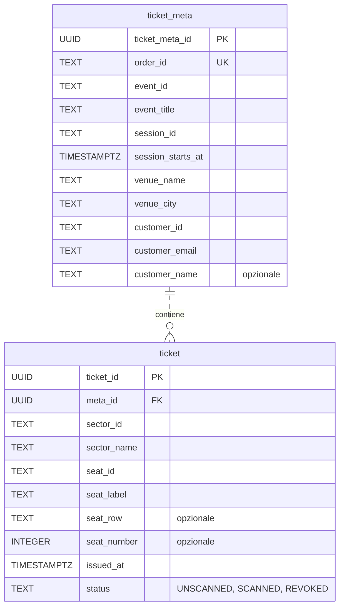

# Appunti di Tickets

## Evento ricevuto da Sales

Per allinearci al formato concordato con Sales, Tickets accetta
`"type": "ORDER_PAID"`. Serde associa questo valore alla variante Rust
`OrderMessage::OrderPaid`.

- Da `data`, Tickets legge `orderId`, `customerId`, `customerEmail` e l’eventuale `customerName`.
- Da `data.event` legge `eventId`, `sessionId`, `eventTitle`, `startsAt`, `venueName` e `venueCity`.
- Da ogni riga di `data.lines` legge `seatId`, `seatLabel`, `sectorId` e `sector`.

Il JSON completo è nella [guida alla prova RabbitMQ](RABBIT_MQ.md).

## Invio dei QR via email

Flusso concordato da implementare.

1. Tickets genera il QR dalla credenziale di ingresso di ciascun biglietto e salva il PNG in un bucket privato su RustFS.
2. Quando tutti i PNG dell’ordine sono disponibili, Tickets pubblica `TICKETS_ISSUED` con `ticketId` e `qrObjectKey` per ciascun biglietto.
3. Notifications usa le chiavi ricevute per scaricare i PNG e allegarli a un’unica email per ordine.

Tickets ricava `qrObjectKey` dal `ticket_id` salvato in PostgreSQL usando
la regola `tickets/<ticketId>/qr.png`. RustFS conserva l’immagine.

Il payload e la gestione dei ritenti sono nella [guida RabbitMQ](RABBIT_MQ.md#notifiche-con-i-qr-in-allegato).

## Schema logico

### Diagramma PostgreSQL

Il diagramma mostra lo schema risultante dalle migrazioni. Ogni `ticket`
punta a una riga di `ticket_meta`, che raccoglie i dati condivisi dell’ordine.
Lo storico delle scansioni è descritto più sotto come tabella prevista.



### `ticket_meta`

```sql
CREATE TABLE ticket_meta (
    ticket_meta_id UUID PRIMARY KEY DEFAULT gen_random_uuid(),
    order_id TEXT NOT NULL UNIQUE,
    event_id TEXT NOT NULL,
    event_title TEXT NOT NULL,
    session_id TEXT NOT NULL,
    session_starts_at TIMESTAMPTZ NOT NULL,
    venue_name TEXT NOT NULL,
    venue_city TEXT NOT NULL,
    customer_id TEXT NOT NULL,
    customer_email TEXT NOT NULL,
    customer_name TEXT
);
```

### `ticket`

```sql
CREATE TABLE ticket (
    ticket_id UUID PRIMARY KEY DEFAULT gen_random_uuid(),
    meta_id UUID NOT NULL REFERENCES ticket_meta (ticket_meta_id),
    sector_id TEXT NOT NULL,
    sector_name TEXT NOT NULL,
    seat_id TEXT NOT NULL,
    seat_label TEXT NOT NULL,
    seat_row TEXT,
    seat_number INTEGER,
    issued_at TIMESTAMPTZ NOT NULL DEFAULT now(),
    status TEXT NOT NULL DEFAULT 'UNSCANNED'
        CHECK (status IN ('UNSCANNED', 'SCANNED', 'REVOKED'))
);
```

### `TICKET_SCAN`

Tabella prevista per il controllo al varco.

```text
TICKET_SCAN(
    scan_id                     PK,
    ticket_id                   FK --> TICKET.ticket_id
    result ENUM(ADMITTED, NOT_ADMITTED)
    scanned_at
)
```

## Regole di vendita

- Ogni ordine contiene biglietti per una sola sessione dello stesso evento.

## Storico delle decisioni

### Integrazione con Sales

- Avevamo considerato un endpoint `POST` per ricevere gli ordini da Sales. Abbiamo scelto di consumare l’evento `ORDER_PAID` da RabbitMQ.
- Sales è responsabile dell’assegnazione dei posti nella sessione e della composizione delle righe d’ordine. Per questo avevamo messo da parte in Tickets i vincoli `UNIQUE (order_id, seat_id)` e `UNIQUE (order_id, order_line_id)`, oltre al vincolo di un solo biglietto per posto nella stessa sessione.
- Il primo schema salvava `order_line_id` nel biglietto. L’emissione crea un biglietto per ciascun elemento di `lines` e usa i dati del posto, quindi abbiamo eliminato quella colonna. `ticket_meta.order_id` è univoco e identifica i dati condivisi da tutti i biglietti dell’ordine.

### Emissione, scansione e notifiche

- Il piano iniziale distingueva emissione e scansione dei biglietti, con l’invio della notifica dopo l’emissione.
- Nella prima bozza il QR conteneva il `ticketId`. Per l’email avevamo previsto il QR, titolo e orario dell’evento, luogo, settore, posto e prezzo. Il [flusso concordato per gli allegati](#invio-dei-qr-via-email) riprende la scelta di salvare le immagini su RustFS.

### Persistenza

- Avevamo previsto un’interfaccia repository per collegare la logica di emissione a un adapter PostgreSQL. La nota iniziale prevedeva di collegare l’adapter nello stato dell’applicazione. Nel codice attuale l’avvio crea l’adapter `PgTickets` e lo passa al consumer RabbitMQ.
- Gli appunti prevedevano il mapping tra i DTO e i tipi usati dal repository per l’ordine, le righe d’ordine e i biglietti.

## TODO

- Rimuovere `gate` dalla risposta di `POST /api/v1/tickets/{ticketId}/scans`. Il varco dipende dalla venue gestita da Catalog.
- Rimuovere `credential_encrypted` dal modello di accesso.
